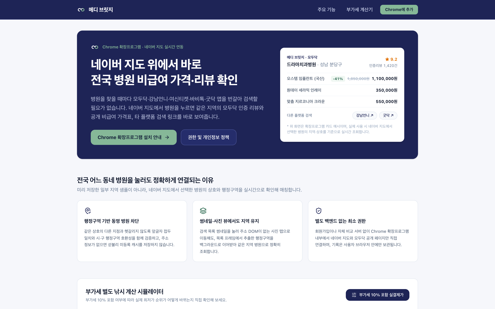
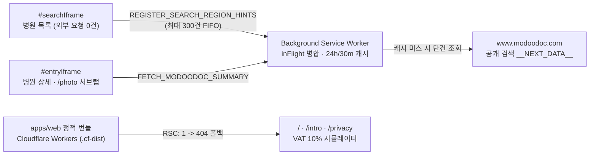

<p align="center">
  <h1 align="center">medi-bridge</h1>
  <p align="center">네이버 지도 병원 비급여 가격 및 인증 리뷰 브릿지 확장 프로그램</p>
  <p align="center"><a href="https://medi-bridge.seungwoo7050.workers.dev">medi-bridge.seungwoo7050.workers.dev</a></p>
  <p align="center">Chrome Extension (MV3) | WXT | React 19 | Next.js 16 | TypeScript | Zod | Cloudflare Workers | Playwright</p>
</p>



네이버 지도에서 치과, 안과, 피부과, 성형외과, 정형외과를 찾을 때 같은 지역의 모두닥 인증 리뷰와 공개 비급여 가격표를 상세 패널 위에 바로 띄우고, 진료과에 맞는 다른 플랫폼(강남언니, 여신티켓, 바비톡, 굿닥) 검색으로 이어 주는 브라우저 확장 프로그램입니다. 별도 크롤링 서버 없이 동작하며, 안내 웹에서 부가세 10% 포함 시 실질 결제 순위가 어떻게 달라지는지 미리 계산해 볼 수 있습니다.

> 비공식 브라우저 확장 도구입니다. 네이버, 모두닥, 강남언니, 여신티켓, 바비톡, 굿닥이 운영하거나 제휴한 서비스가 아닙니다.

## 주요 기능

| 영역 | 돕는 일 |
| --- | --- |
| **상세 패널 카드** | 네이버 지도 병원 상세(`/home`)나 사진(`/photo`) 탭을 열면 같은 지역의 모두닥 별점, 인증 리뷰 수, 시술별 가격과 할인율을 상단에 표시합니다 |
| **검색 목록 미니 버튼** | 검색 결과 목록(스폰서 광고 행 포함) 옆에 작은 바로가기 칩을 붙여 원하는 병원을 바로 확인하거나 외부 검색으로 이동합니다 |
| **툴바 팝업** | 확장 기능 사용 여부를 켜고 끄며 최근 확인한 병원 최대 20건의 열람 기록과 가격 요약을 다시 열어 봅니다 |
| **안내 웹 및 부가세 계산기** | 스마일라식, 인모드 FX, 국산 임플란트 사례에서 부가세 10% 포함 여부에 따른 순위 역전과 최소 권한 정책(`/privacy`)을 확인합니다 |

- 검색 목록을 여는 단계에서는 외부 사이트로 자동 조회 요청을 보내지 않고(0건), 사용자가 병원을 열어 볼 때만 해당 병원을 단건 조회합니다.
- 로그인이나 계정, 별도 백엔드 서버 없이 브라우저 내부에서만 동작합니다.
- `storage` 권한과 필수 3개 도메인(`map.naver.com`, `pcmap.place.naver.com`, `www.modoodoc.com`) 외의 권한은 요구하지 않습니다.
- 최근 열람 이력과 단기 캐시는 모두 사용자 브라우저의 `chrome.storage.local`에만 저장됩니다.

## 아키텍처와 핵심 설계



### 1. 크로스 프레임 행정구역 중계와 실시간 SSR 파싱

네이버 지도는 검색 목록(`#searchIframe`)과 병원 상세(`/home`, `/photo` 등이 열리는 `#entryIframe`)가 서로 다른 문서로 나뉘어 있습니다. 목록 썸네일을 눌러 사진 서브탭이 열리면 상세 화면에 주소와 진료과 표시가 빠지므로, 목록 프레임([apps/extension/src/entrypoints/naver-place.content/index.tsx](apps/extension/src/entrypoints/naver-place.content/index.tsx))에서 미리 뽑아 둔 `시/구` 힌트를 Service Worker([apps/extension/src/entrypoints/background.ts](apps/extension/src/entrypoints/background.ts))의 FIFO 맵(`MAX_SEARCH_REGION_HINTS = 300`)에 보관했다가 상세 탭 요청에 이어 붙입니다. 캐시에 없는 병원만 모두닥 공개 검색 페이지의 `__NEXT_DATA__` React Query 상태를 파싱하며, 같은 병원 중복 요청은 진행 중 Promise 하나로 병합하고 성공 결과는 24시간, 정상 미등록 결과는 30분 동안 캐시합니다.

### 2. 동명이원 오매칭 차단과 부정 캐시 오염 방어

부분 문자열 일치만으로는 접두 지역명이 다른 타 병원이 섞일 수 있어 [packages/shared/src/hospitalMatcher.ts](packages/shared/src/hospitalMatcher.ts)에서 `scoreNameMatch`를 정확 일치와 양방향 접두 일치(`startsWith` 80점)로 좁히고 `SIDO_MAP` 기반 행정구역 호환성을 교차 검증합니다. 상세 탭과 릴레이에서 모두 지역을 찾지 못한 상태라면 90점 미만 후보는 탈락시키고([packages/parsers/src/modoodocParser.ts](packages/parsers/src/modoodocParser.ts)), HTML 구조 오류(`parse_error`)나 지역 미확정 상태의 미등록(`not_found`)은 부정 캐시에 저장하지 않아 뒤늦게 도착하는 정상 조회가 막히지 않게 했습니다. 모두닥 미등록 병원이나 타 플랫폼 비교에는 진료과에 맞는 외부 검색 링크(`buildExternalPlatformLinks`)를 폴백 카드로 연결합니다.

### 3. 서브탭 고정 탭바 스페이서 앵커링과 Shadow DOM 격리

사진이나 리뷰 서브탭에서는 상단 탭바(`.place_fixed_maintab`)가 고정되고 본문이 위로 스크롤되어 헤더 기준 노드가 화면 밖에 놓입니다. [apps/extension/src/adapters/naverEntryDom.ts](apps/extension/src/adapters/naverEntryDom.ts)의 `resolveSubTabAnchor`는 고정 탭바 뒤 빈 스페이서 요소 다음에 카드를 삽입하고 `previousElementSibling`이 달라지면 즉시 재정렬하며, 스폰서 광고 행(`.KJzzB .D1dXu`)은 [apps/extension/src/adapters/naverSearchListDom.ts](apps/extension/src/adapters/naverSearchListDom.ts)의 `resolveAdFallbackCategory`가 병원명과 함께 판별해 목록 칩이 누락되지 않게 합니다. 주입된 UI는 모두 Shadow DOM으로 감싸고 `:host { all: initial }` 리셋 위에서 폰트와 `16px` 서브탭 여백(`.mb-wrapper.is-subtab`)을 직접 지정합니다.

### 4. 단일 쓰기 큐와 정적 Cloudflare Workers 서빙

Content script, 팝업, Service Worker가 동시에 `browser.storage.local`을 읽고 덮어쓰면 최근 열람 기록이 유실될 수 있으므로 [apps/extension/src/domain/bridgeStorage.ts](apps/extension/src/domain/bridgeStorage.ts)의 `enqueueWrite` FIFO Promise 큐로 이력 변이를 직렬화했습니다. 안내 웹(`apps/web`)은 Next.js 정적 빌드 산출물을 [apps/web/scripts/build-cf-bundle.mjs](apps/web/scripts/build-cf-bundle.mjs)로 조립해 Cloudflare Workers Static Assets에 올렸으며, Next.js 프리페치(`RSC: 1`) 헤더가 HTML을 받아 파싱 오류를 내지 않도록 [apps/web/cloudflare/worker.ts](apps/web/cloudflare/worker.ts)에서 404 폴백을 반환합니다. 부가세 10% 실질가 계산(`computeEffectivePrice`)과 천 단위 콤마 포맷(`formatPriceKRW`, `tabular-nums`)은 [packages/shared/src/vatNormalizer.ts](packages/shared/src/vatNormalizer.ts)에서 확장과 웹이 함께 씁니다.

## 프로젝트 구성

- **Chrome MV3 확장 (`apps/extension`)**: WXT, React 19, TypeScript, Tailwind CSS v4, Shadow DOM 오버레이 및 툴바 팝업
- **정적 안내 웹 (`apps/web`)**: Next.js 16, React 19, Tailwind CSS v4, 부가세 시뮬레이터(`/`, `/intro`) 및 개인정보처리방침(`/privacy`), Cloudflare Workers 정적 번들러
- **공용 패키지 (`packages/*`)**: 도메인 매칭·VAT 계산(`shared`), 모두닥 SSR 파서(`parsers`), 공용 배지 토큰(`ui`)
- **검증 및 CI (`.github/workflows/ci.yml`)**: TypeScript, Biome, Vitest, Chrome MV3 & 정적 웹 Playwright E2E

```text
medi-bridge/
├── .github/workflows/ci.yml   PR·main 푸시 정적 검사, 빌드, 권한 검사, E2E 워크플로
├── apps/extension/            WXT Chrome MV3 확장 (Content Script, Background SW, Popup, E2E)
├── apps/web/                  정적 랜딩, 부가세 시뮬레이터, 개인정보처리방침, Cloudflare Worker
├── packages/shared/           접두 상호명 매칭, 행정구역 검증, VAT 10% 포맷, 플랫폼 URL 빌더
├── packages/parsers/          모두닥 __NEXT_DATA__ SSR 파서 및 오프라인 픽스처 테스트
├── packages/ui/               공용 디자인 토큰 및 SVG 브랜드 배지
└── assets/                    안내 웹 및 스토어 미리보기 이미지
```

## 로컬 실행 및 검증

Node.js 22 이상과 `pnpm` 12 환경이 필요합니다.

```bash
pnpm install
pnpm build
pnpm zip:ext
```

Chrome에서 로컬 확장 프로그램을 불러와 직접 확인하는 순서입니다.

1. 주소창에서 `chrome://extensions`로 이동해 우측 상단 **개발자 모드**를 켭니다.
2. **압축해제된 확장 프로그램을 로드합니다**를 눌러 `apps/extension/output/chrome-mv3` 폴더를 선택합니다.
3. [네이버 지도](https://map.naver.com)에서 치과, 안과, 피부과, 성형외과, 정형외과 병원을 열고 상세·사진 탭 카드와 목록 칩을 확인합니다.

| 명령 | 설명 |
| --- | --- |
| `pnpm verify` | 5개 워크스페이스 타입 체크, Biome 린트·포맷 검사, Vitest 단위 테스트 실행 |
| `pnpm build` | 확장(`output/chrome-mv3`)과 Next.js 안내 웹 전체 빌드 |
| `pnpm zip:ext` | Chrome Web Store 업로드용 ZIP 패키지(`apps/extension/output/`) 생성 |
| `pnpm test:e2e` | 빌드된 Chrome MV3 확장(지역 중계 `/photo` 포함)과 정적 웹 Playwright E2E 실행 |
| `pnpm --filter @medi-bridge/web run deploy:cf` | `.cf-dist` 정적 번들을 조립해 Cloudflare Workers에 배포 |

CI 파이프라인([`.github/workflows/ci.yml`](.github/workflows/ci.yml))은 모든 Pull Request와 `main` 푸시에서 `pnpm verify`, 확장·정적 웹 빌드, `manifest.json` 최소 권한 검사, Playwright E2E를 순서대로 실행합니다.

## 현재 상태와 검증 범위

정적 안내 웹(`/`, `/intro`, `/privacy`)은 Cloudflare Workers에 배포되어 있고, Chrome MV3 확장 빌드는 로컬 개발자 모드 테스트와 오프라인 E2E, 실제 네이버 플레이스 사진 서브탭 실통신 검증까지 마쳤습니다.

- **직진입 및 외부 링크 범위**: 검색 목록 프레임을 거치지 않고 `/hospital/<id>/photo` 주소로 바로 들어가면 중계된 지역 힌트가 없어 90점 이상 완전·정규화 상호만 매칭하며, 모두닥 외 4개 플랫폼(강남언니, 여신티켓, 바비톡, 굿닥)은 진료과 맞춤형 검색 결과 페이지로 연결합니다.
- **남은 출시 작업**: Chrome Web Store 심사 등록 후 발급되는 설치 URL을 안내 웹 상단 버튼과 설치 섹션에 반영할 예정입니다.
