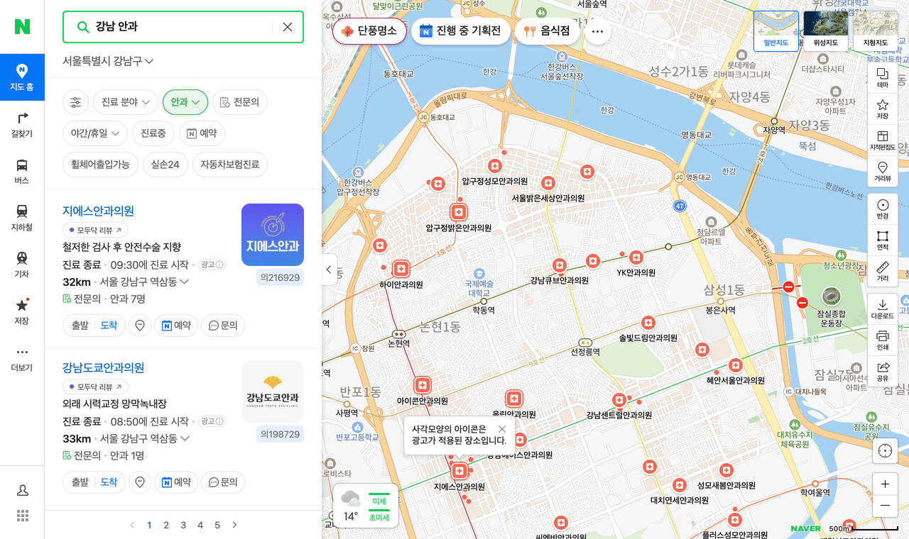

# 모두닥 리뷰 브릿지 for 네이버 지도

네이버 지도에서 병원을 찾는 사용자가 클릭 한 번으로 모두닥의 실방문자 영수증 리뷰 검색 화면으로 이동할 수 있게 돕는 Chrome Extension(Manifest V3)입니다.



---

## 왜 만들었나

병원 위치와 진료 시간을 확인할 때 많은 사용자가 네이버 지도를 먼저 엽니다. 다만 포털 지도의 리뷰만으로는 실제 내원 환자의 후기나 비급여 진료비 감각을 가늠하기 어렵습니다. 결국 모두닥(`modoodoc.com`) 웹이나 앱을 따로 열어 지역명과 병원명을 다시 입력해야 하는데, 이 과정에서 탐색 흐름이 끊기기 쉽습니다.

이 확장프로그램은 네이버 지도 검색 결과 목록과 병원 상세 패널에 모두닥 연결 버튼만 조용히 덧붙여, 병원 탐색과 영수증 리뷰 확인 사이의 왕복 비용을 줄이는 데 집중했습니다.

---

## 주요 기능

- **검색 결과 목록 미니 버튼 (`#searchIframe`)**: 병원명 아래에 컴팩트한 `[모두닥 리뷰 ↗]` 버튼을 표시해, 상세 패널을 열기 전에도 여러 후보 병원의 리뷰를 새 탭으로 빠르게 비교할 수 있습니다.
- **병원 상세 패널 배지 (`#entryIframe`)**: 상세 화면 진료과 정보 바로 아래에 `[모두닥 영수증 리뷰 보기 ↗]` 배지를 띄웁니다. 상세 주소에서 시·구 단위 지역 힌트를 뽑아 병원명과 함께 모두닥 검색 쿼리로 넘깁니다.
- **비대상 업종 필터링**: 치과, 피부과, 안과, 정형외과, 한의원 등 핵심 진료과와 병·의원은 허용하고, 이름에 병원이나 진료과 단어가 들어가더라도 동물병원, 약국, 요양병원, 산후조리원, 피부관리실 등은 제외합니다.
- **툴바 팝업 제어 및 최근 본 병원 히스토리**: 확장 아이콘을 누르면 네이버 지도 내 배지 자동 표시를 켜고 끌 수 있고(열려 있는 탭에 즉시 반영), 직접 검색창과 최근 본 병원 최대 20건 히스토리(리뷰 클릭 여부 포함)를 확인할 수 있습니다.

---

## 구조와 설계 판단

```text
src/
├── types/          # 도메인·DOM 추출·스토리지 타입 정의
├── domain/         # 진료과 필터, 모두닥 URL 빌더, browser.storage.local 상태 관리
├── adapters/       # 네이버 지도 #entryIframe / #searchIframe 다중 폴백 DOM 파서
├── components/     # Shadow DOM 내부에 렌더링되는 React 배지 및 미니 버튼
├── entrypoints/
│   ├── naver-place.content/  # allFrames Content Script (디바운스 MutationObserver + Shadow UI)
│   └── popup/                # 확장프로그램 툴바 팝업 React UI
e2e/                # Playwright 기반 크롬 확장프로그램 E2E 테스트
```

1. **다중 iframe 대응과 디바운스 감시**: 네이버 지도는 검색 목록(`#searchIframe`)과 상세 패널(`#entryIframe`)을 `pcmap.place.naver.com` 서브 프레임으로 분리해 렌더링합니다. `setInterval` 폴링 대신 `120ms` 디바운스 `MutationObserver`를 두 프레임 각각에 붙여 SPA 화면 전환을 감지합니다.
2. **Shadow DOM 스타일 격리**: 네이버 지도는 호스트 문서의 `rem` 기준 폰트 크기를 조정하므로, WXT `createShadowRootUi`와 `px` 고정 치수를 사용해 호스트 CSS와 확장 UI 스타일이 서로 간섭하지 않도록 분리했습니다. 목록 미니 버튼에는 `isolateEvents`와 `stopPropagation`을 적용해 버튼을 눌렀을 때 상위 카드 클릭이 함께 동작하지 않게 막았습니다.
3. **다중 폴백 셀렉터 분리**: 네이버 지도 프론트엔드 빌드마다 난독화 클래스명이 바뀔 수 있어 셀렉터 탐색을 `src/adapters/`로 격리하고, 최신 셀렉터와 이전 구조 폴백을 배열 우선순위로 관리합니다.
4. **최소 권한과 무크롤링**: `manifest.json` 권한은 팝업 토글과 최근 본 병원 저장에 필요한 `storage`와 네이버 지도 호스트(`map.naver.com`, `pcmap.place.naver.com`)만 선언했습니다. 모두닥 비공개 API 호출이나 자동 크롤링 없이, 사용자가 버튼을 클릭할 때만 공개 검색 URL(`https://www.modoodoc.com/hospitals/query-search?search_query=...`)을 새 탭으로 엽니다.

---

## 로컬 설치 및 실행 방법

사전 요구사항: Node.js 22+, `pnpm`

```bash
# 1. 의존성 설치
pnpm install

# 2. 프로덕션 빌드 (.output/chrome-mv3 생성)
pnpm build
```

빌드 후 Chrome에서 아래 순서로 로드해 바로 사용할 수 있습니다.

1. 주소창에 `chrome://extensions` 입력 후 이동
2. 우측 상단 **개발자 모드(Developer mode)** 활성화
3. 좌측 상단 **압축해제된 확장 프로그램을 로드합니다(Load unpacked)** 클릭 후 `.output/chrome-mv3` 폴더 선택
4. [네이버 지도](https://map.naver.com)에서 치과, 안과, 피부과 등 병원을 검색해 목록 버튼과 상세 패널 배지 동작 확인

(`pnpm zip`을 실행하면 `.output/modoodoc-naver-bridge-0.1.0-chrome.zip` 패키지가 생성됩니다.)

---

## 검증 명령어

```bash
# TypeScript strict 타입 체크 + Biome 린트/포맷 + Vitest 단위 테스트
pnpm verify

# 빌드된 확장프로그램(.output/chrome-mv3) Playwright E2E 검증
pnpm test:e2e
```
